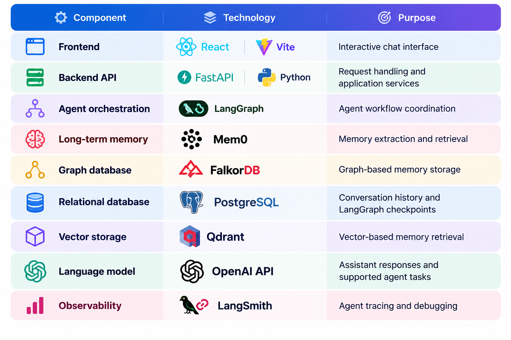
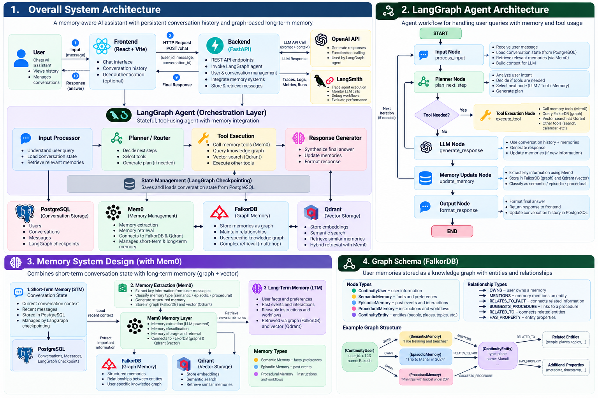
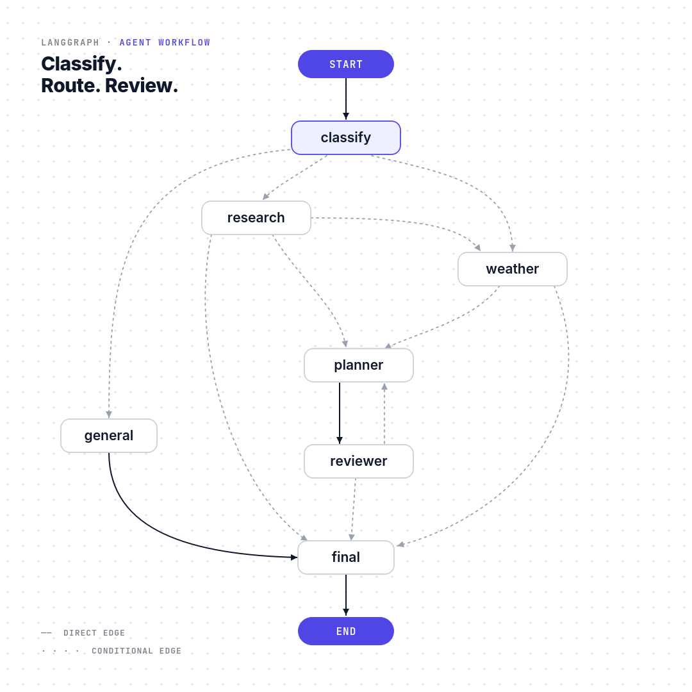

# Personal Assistant

### A Memory-Aware AI Assistant Powered by FalkorDB, Graph-Based Long-Term Memory

Personal Assistant is an AI-powered assistant designed to maintain useful context across conversations, remember user preferences, and provide more personalized responses over time.

Unlike a basic chatbot that primarily responds to the current prompt, Personal Assistant combines **short-term conversational memory, graph-based long-term memory, and persistent conversation history** to create a more continuous user experience.

Built with **LangGraph, Mem0, FalkorDB, PostgreSQL, FastAPI, and React**, the project explores how AI agents can retrieve relevant information from previous interactions, maintain context within individual conversation threads, and support more personalized assistance.

The goal is simple: build an assistant that doesn't just respond to messages, but can use relevant context from past interactions to make future conversations more useful.

## Key Features

- **Short-Term Memory (STM):** Maintains conversational context within a thread using LangGraph checkpointing and PostgreSQL.
- **Graph-Based Long-Term Memory (LTM):** Uses Mem0 and FalkorDB to store and retrieve relevant information across conversations.
- **Persistent Conversation History:** Stores conversation metadata and messages in PostgreSQL so previous chats can be reopened.
- **Agent Orchestration:** Uses LangGraph to coordinate the assistant's processing and specialized workflows.
- **Personalized Responses:** Uses retrieved long-term memories to help tailor responses to relevant user preferences and past interactions.
- **Modern Web Interface:** Provides a React-based chat interface connected to a FastAPI backend.
- **Observability:** Integrates LangSmith for tracing and inspecting supported agent executions.

## The Problem

Most basic conversational interfaces treat each interaction as an isolated request or rely on limited conversation context. This can make users repeat information, preferences, and requirements across sessions.

Personal Assistant explores a memory-aware approach in which conversational context, persistent chat history, and graph-based long-term memories work together.

## The Solution

Personal Assistant separates memory into complementary layers:

1. **Short-term memory** maintains the context of an ongoing conversation thread.
2. **Long-term memory** stores and retrieves relevant information across conversations through Mem0 and FalkorDB.
3. **Persistent conversation history** allows users to revisit previous chats through PostgreSQL-backed APIs.

Together, these components provide the foundation for a more continuous, context-aware AI assistant.

## Technology Stack



## System Architecture

The Personal Assistant uses a modular architecture that separates the user interface, API layer, agent orchestration, short-term conversation state, and long-term memory.

### Architecture Components

1. **Frontend — React + Vite:** Provides the chat interface, conversation history, and user interactions.
2. **Backend — FastAPI:** Exposes HTTP endpoints for chat requests and conversation management.
3. **Agent Orchestration — LangGraph:** Coordinates the assistant's workflow and manages stateful execution.
4. **Short-Term Memory (STM) — PostgreSQL:** Stores conversation history and LangGraph checkpoints for persistent conversation state.
5. **Long-Term Memory (LTM) — Mem0:** Supports extracting, storing, and retrieving relevant information across conversations.
6. **Graph Storage — FalkorDB:** Stores graph-based memory representations and relationships used by the configured memory integration.
7. **Vector Storage — Qdrant:** Supports vector-based memory retrieval.
8. **Observability — LangSmith:** Supports tracing and debugging of agent execution.

### Request Flow

1. The user sends a message through the React interface.
2. The frontend sends the request to the FastAPI backend.
3. The backend identifies the user and conversation thread.
4. LangGraph processes the request using the configured workflow and checkpointing.
5. The assistant retrieves relevant long-term memories when supported by the workflow.
6. The language model generates a response.
7. The backend persists the conversation and returns the response to the frontend.
8. LangSmith provides observability into supported execution paths.

##  Graph Schema and Memory Model

FalkorDB provides graph-based storage for the configured long-term memory integration. A graph representation can connect user-scoped memories with relevant entities and relationships.

### Logical Memory Types

| Memory Type | Purpose | Example |
|---|---|---|
| Semantic Memory | Stores useful facts and preferences | A user's preferred travel style |
| Episodic Memory | Represents past experiences or interactions | A previously planned trip |
| Procedural Memory | Represents reusable instructions or workflows | A preferred process for planning a trip |

### Proposed Nodes

| Node Label | Purpose |
|---|---|
| `ContinuityUser` | Represents the user associated with memories |
| `SemanticMemory` | Represents factual information and preferences |
| `EpisodicMemory` | Represents events and interaction-related information |
| `ProceduralMemory` | Represents reusable instructions |
| `ContinuityEntity` | Represents an entity connected to a memory |

### Proposed Relationships

| Relationship | Meaning |
|---|---|
| `OWNS` | Connects a user to a memory |
| `MENTIONS` | Connects a memory to an entity |
| `RELATES_TO_FACT` | Connects related information |
| `SUGGESTS_PROCEDURE` | Connects information to a relevant procedure |

**Implementation note:** These labels and relationships describe the intended logical model. The actual node labels, edge types, properties, and retrieval queries must match the schema created by the running application. Mem0 may manage its own graph representation, so custom labels should not be presented as verified until confirmed.



## LangGraph Agent Architecture



## ⚙️ Installation and Setup

Follow these instructions to run the Personal Assistant locally.

### Prerequisites

Install the following software before starting:

- **Python 3.11+** — Backend and agent execution.
- **Node.js and npm** — Frontend development.
- **Docker Desktop** — Running containerized database services.
- **Git** — Source control.
- **OpenAI API key** — Language model access.
- **LangSmith API key** — Optional, for agent tracing and observability.

The project also uses PostgreSQL, FalkorDB, and Qdrant for conversation persistence and memory storage.

### 1. Clone the Repository

```bash
git clone <YOUR_GITHUB_REPOSITORY_URL>
cd "Graph Hacks"
```


### 2. Create and Activate a Python Virtual Environment

On Windows PowerShell:

```powershell
python -m venv venv
.\venv\Scripts\Activate.ps1
```

Upgrade pip and install the backend dependencies:

```powershell
python -m pip install --upgrade pip
pip install -r requirements.txt
```

### 3. Configure Environment Variables

Create a `.env` file in the project root. If the repository contains `.env.example`, copy it and update the values.

```powershell
Copy-Item .env.example .env
```

Configure the required API keys, database connections, and application settings in `.env`.

**Important:** Use the actual variable names defined in `app/config.py` and `.env.example`. Do not commit your `.env` file or expose API keys in your repository.

### 4. Start the Database Services

If your project uses Docker Compose, start the configured services:

```bash
docker compose up -d
```

Verify that the required containers are running:

```bash
docker ps
```

Ensure PostgreSQL, FalkorDB, and Qdrant are reachable using the connection settings in your `.env` file.

### 5. Install Frontend Dependencies

Open a terminal in the frontend directory:

```bash
cd frontend
npm install
```
## Running the Application Locally

The backend and frontend run as separate development processes.

### 1. Start the Backend

Open a terminal in the project root:

```powershell
cd "D:\DEV\Graph Hacks"
.\venv\Scripts\Activate.ps1
python -m uvicorn app.main:app --reload
```

The FastAPI backend should be available at:

- **API base URL:** http://127.0.0.1:8000
- **Interactive API documentation:** http://127.0.0.1:8000/docs
- **Health check:** http://127.0.0.1:8000/api/v1/health

Keep this terminal running.

### 2. Start the Frontend

Open a second terminal:

```powershell
cd "D:\DEV\Graph Hacks\frontend"
npm run dev
```

Open the local frontend URL printed by Vite. With the default configuration, this is:

http://localhost:5173

### 3. Test the Application

1. Open the frontend in your browser.
2. Send a message to the assistant.
3. Create another conversation and send a new message.
4. Refresh the page and verify that conversation history is restored.
5. Test whether relevant long-term memories are retrieved across conversations for the same user.
6. Check the backend logs if a request fails.

### Troubleshooting

- **Backend startup errors:** Check the virtual environment, installed dependencies, and `.env` configuration.
- **Database connection errors:** Verify Docker containers, ports, credentials, and database availability.
- **Frontend API errors:** Check the backend URL and CORS configuration.
- **Memory retrieval errors:** Verify Mem0, FalkorDB, Qdrant, and their connection settings.
- **Port conflicts:** Stop the conflicting process or configure an available port.

## API Documentation

The backend exposes REST endpoints through FastAPI.

### Base URL

```text
http://127.0.0.1:8000
```

Interactive documentation is available at:

http://127.0.0.1:8000/docs

### API Endpoints

| Method | Endpoint | Description |
|---|---|---|
| `GET` | `/api/v1/health` | Checks backend health. |
| `POST` | `/api/v1/chat` | Sends a message to the assistant. |
| `GET` | `/api/v1/conversations` | Lists conversations for a user. |
| `GET` | `/api/v1/conversations/{thread_id}` | Retrieves a conversation and its messages. |
| `DELETE` | `/api/v1/conversations/{thread_id}` | Deletes a conversation. |

### 1. Health Check

**Request**

```http
GET /api/v1/health
```

Use this endpoint to verify that the backend is responding. Check the actual response schema in `/docs`.

### 2. Send a Chat Message

**Request**

```http
POST /api/v1/chat
Content-Type: application/json
```

**Example request body**

```json
{
  "user_id": "demo-user",
  "thread_id": "conversation-001",
  "message": "Hello! What can you help me with?"
}
```

**Purpose**

- `user_id` identifies the user whose data and memories are being accessed.
- `thread_id` identifies the conversation.
- `message` contains the user's input.

**Example response shape**

```json
{
  "answer": "Hello! How can I help you today?",
  "user_id": "demo-user",
  "thread_id": "conversation-001",
  "memory_warning": null
}
```

The answer shown above is illustrative. The actual assistant response and `memory_warning` value depend on execution.

### 3. List Conversations

**Request**

```http
GET /api/v1/conversations?user_id=demo-user
```

Retrieves the conversations associated with the specified user, according to the backend's conversation-store implementation.

### 4. Retrieve a Conversation

**Request**

```http
GET /api/v1/conversations/conversation-001?user_id=demo-user
```

Retrieves a particular conversation and its stored messages.

### 5. Delete a Conversation

**Request**

```http
DELETE /api/v1/conversations/conversation-001?user_id=demo-user
```

Deletes the specified conversation using the backend's conversation-management endpoint.

Verify the deletion behavior and response status in the running API documentation.

### Memory and Conversation Identifiers

The application uses two important identifiers:

- **User ID:** Associates conversations and long-term memory with a user.
- **Thread ID:** Separates the state and history of individual conversations.

Different threads can have separate short-term conversation state while sharing relevant long-term memories for the same user, provided the memory integration is configured and retrieval succeeds.

### API Security

The example requests use demonstration identifiers. A production deployment should implement authentication and authorization, enforce user-level access controls, validate inputs, and protect stored conversations and memories.

Do not treat a client-supplied `user_id` as proof of identity.


